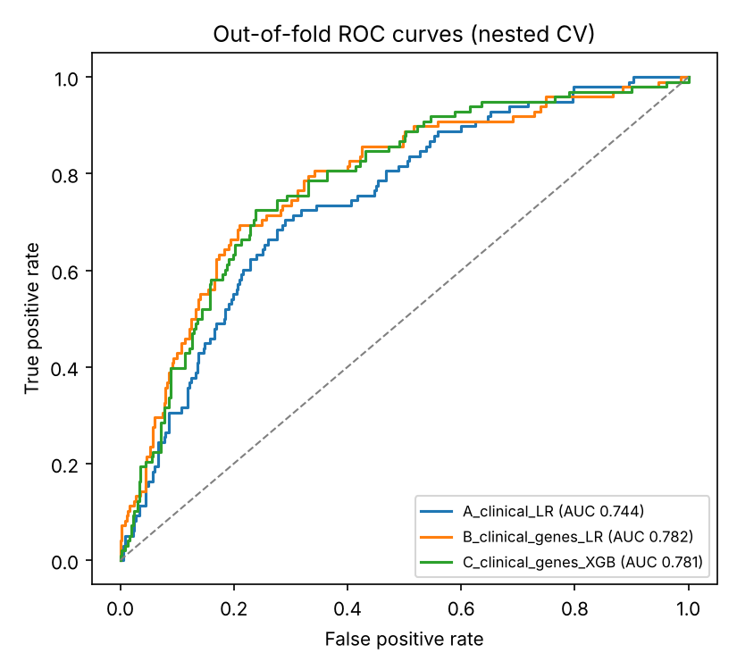
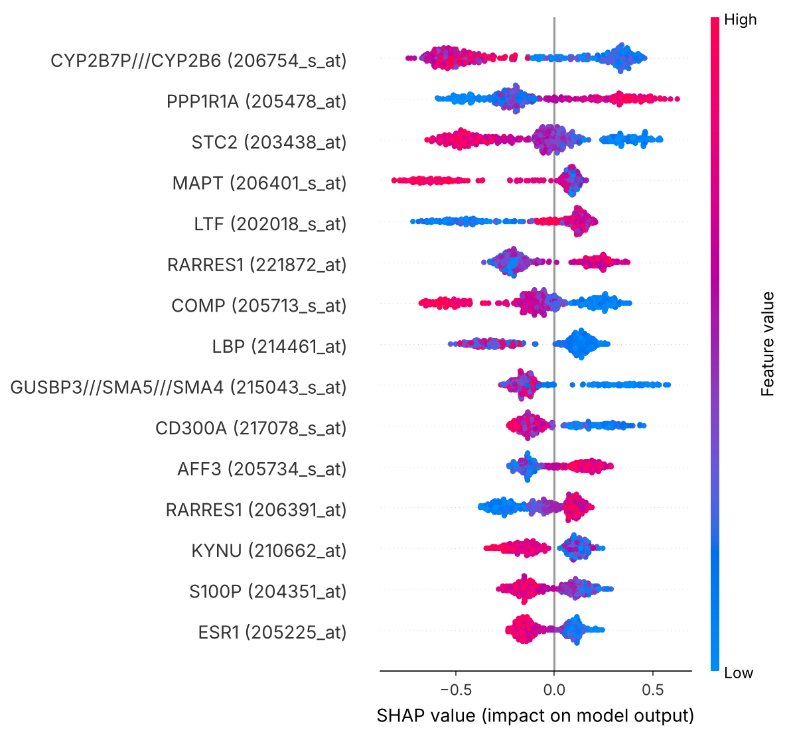

# DrugResponse — predicting pCR to neoadjuvant chemotherapy in breast cancer

**Question.** Does tumour gene expression measured before treatment predict pathological complete response (pCR) better than standard clinical features?

**Answer.** Slightly, but the gain is not statistically significant. Clinical features alone reach ROC-AUC 0.744. Adding gene expression gives 0.782, and the bootstrap 95% CI of the gain (−0.007 to +0.085) includes zero.

[](https://colab.research.google.com/github/dianalaplace/DrugResponse/blob/main/notebooks/DrugResponse_full.ipynb)

## Results (out-of-fold predictions, nested CV, n = 460)

Source of every number below: [`notebooks/DrugResponse_full.ipynb`](notebooks/DrugResponse_full.ipynb), saved in [`results/notebook/`](results/notebook/) together with [`run_manifest.json`](results/notebook/run_manifest.json) (package versions, data checksums, cohort size).

| Model | ROC-AUC (95% CI) | PR-AUC | Brier |
|---|---|---|---|
| A — clinical, logistic regression | 0.744 (0.692–0.793) | 0.406 | 0.208 |
| **B — clinical + genes, logistic regression** | **0.782 (0.725–0.831)** | **0.501** | 0.170 |
| C — clinical + genes, XGBoost | 0.781 (0.730–0.827) | 0.459 | 0.149 |

PR-AUC of a random model = 0.213. Gain B − A: **+0.038 (95% CI −0.007 to +0.085)**.

| Subtype | n | pCR rate | A | B | C |
|---|---|---|---|---|---|
| HR+/HER2− | 268 | 11% | 0.689 | 0.703 | 0.702 |
| HER2+ | 61 | 38% | 0.667 | 0.693 | 0.757 |
| TNBC | 129 | 35% | 0.559 | 0.774 | 0.725 |

Genes help most within triple-negative tumours, where clinical features carry little signal. The HER2+ group is small, so its AUCs are unstable.



### Model interpretation (SHAP)



Top features by mean |SHAP| ([table](results/notebook/shap_top15.csv)) include CYP2B7P, PPP1R1A, STC2, LTF, RARRES1 and ESR1. The earlier pipeline in `src/` ranks largely the same genes at the top (RARRES1, PPP1R1A, CYP2B7P, LTF, ESR1). SHAP explains the model, not biology: these genes are hypotheses.

SHAP values come from `shap.TreeExplainer`. If an installed `shap` version is incompatible with `xgboost`, both the notebook and `src/best_response_model.py` fall back to XGBoost's native `pred_contribs`, which computes the same TreeSHAP values, instead of crashing.

## Data

| Cohort | Centre / study | Regimen | Patients with label | pCR rate |
|---|---|---|---|---|
| [GSE25065](https://www.ncbi.nlm.nih.gov/geo/query/acc.cgi?acc=GSE25065) | MD Anderson | taxane → anthracycline | 182 | 23% |
| [GSE20194](https://www.ncbi.nlm.nih.gov/geo/query/acc.cgi?acc=GSE20194) | MAQC-II | paclitaxel + FAC | 278 | 20% |

Both use the Affymetrix HG-U133A array (GPL96): 22,215 probes after removing control probes. The notebook downloads the files from GEO itself.

## Method

1. Parse GEO series matrices; harmonise clinical features (age, ER, PR, HER2, T stage, N stage, grade).
2. Drop columns that leak the outcome: other models' pCR predictions (`dlda30_prediction`, `rcb_0_i_prediction`, `chemosensitivity_prediction`) and the post-surgery `pathologic_response_rcb_class`.
3. Centre every probe within each cohort (label-free batch correction).
4. **Nested cross-validation:** 5 stratified outer folds estimate performance; 3 inner folds tune hyperparameters. Imputation, selection of the top-k most variable probes and scaling are fitted inside each training fold only.
5. Bootstrap (1,000 resamples) for 95% CIs of AUC and of the AUC gain; subgroup AUC; SHAP on the final XGBoost model.

## Reproduce

```bash
pip install -r requirements-notebook.txt
jupyter nbconvert --to notebook --execute notebooks/DrugResponse_full.ipynb --output DrugResponse_full.ipynb
```

About 5 minutes on a laptop CPU. Exact versions used for the published numbers are pinned in `requirements-notebook.txt` and recorded in `results/notebook/run_manifest.json`.

## Version history of the numbers

- **Current (Nov 2026).** n = 460, B = 0.782. Two fixes in the notebook:
    1. GEO series matrices can mix different characteristics on the same line; the parser now reads the key of every cell. Before the fix, 10 GSE20194 patients lost their pCR label (n = 450) and a few clinical values were misread.
    2. Probes were z-scored within each cohort before selecting the most variable ones, which made the variance-based selection close to random. Probes are now only centred per cohort; scaling happens inside the pipeline after selection.
- **Earlier notebook version.** n = 450, B = 0.780 — superseded by the fixes above.
- **Earlier pipeline in `src/`** (`run_best_response_model.py`: gene-level features, 3 × 2 or 5 × 3 nested CV, XGBoost). Same 460 patients; clinical + genes ROC-AUC ≈ 0.78. Kept for transparency; the notebook is the reference.

## Limitations

- 460 patients from two US cohorts on an older microarray platform.
- No truly external test set: both cohorts are pooled and evaluated by cross-validation. Next step: train on one cohort, test on the other, then on a modern RNA-seq cohort.
- Per-cohort centring assumes similar case mix in both cohorts.
- Regimens predate current standards with immunotherapy and anti-HER2 drugs.

## Repository layout

```
notebooks/DrugResponse_full.ipynb   reference analysis, executed, with outputs
results/notebook/                   metrics, subgroup AUC, SHAP table, figures, run_manifest.json
requirements-notebook.txt           pinned versions for the notebook
run_best_response_model.py, src/    earlier pipeline (gene-level, also runs SHAP with the fallback)
scripts/, signatures/               figure generation and gene-set references for the earlier pipeline
```
